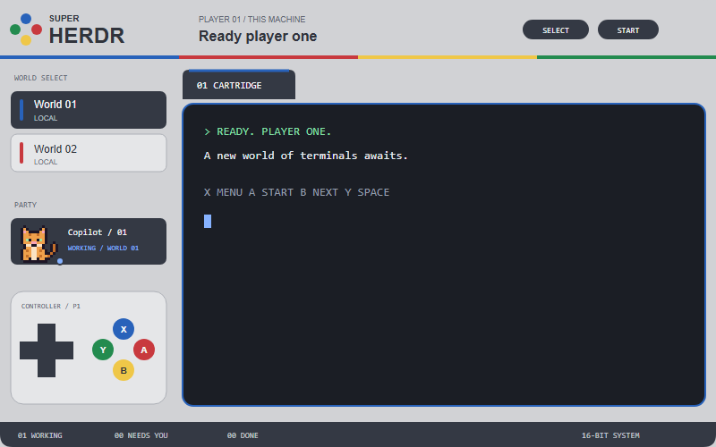

# Super Herdr

A European/Japanese SNES-inspired layout for Herdr: a light-grey console shell, cartridge tabs, dark terminal frames, a functional controller, and Pixelherd animal avatars inside the existing agent rows.



The preview is an illustration with fictional workspace and terminal content, not a capture of a personal session.

## Requirements

- Herdr, installed and started at least once. Tested with Herdr 0.1.14.
- The `herdr-app` command available in your terminal.
- PowerShell 7 or newer for the Windows installer.

No separate Pixelherd installation, extra fonts, Node.js packages, or build step is needed. The layout uses Herdr's shipped Geist/Geist Mono fonts, menu mods, settings icon, and window-control icons.

## Install on Windows

Download or copy this whole repository to the other machine. In PowerShell 7, open the repository folder and run:

```powershell
.\install.ps1
```

The installer copies the layout and its mod into `~\.config\herdr-app`, then runs Herdr's native mod check. It refuses to overwrite an existing `mods\snes`, `layouts\snes.json`, or `layouts\snes.svg`. It does not change settings, shortcuts, sessions, or the selected layout.

After installation succeeds, activate the layout:

```powershell
herdr-app do layout.switch --name snes
```

`.\install.ps1 -WhatIf` previews the installation after checking prerequisites and name conflicts. `-HerdrHome 'C:\path\to\herdr-app'` supports a custom configuration folder; use it only for the configuration your Herdr installation actually uses.

If PowerShell blocks the script, follow your machine's script-execution policy or use the manual installation below.

## Manual installation, including macOS and Linux

Start Herdr once so that its configuration and shipped mods exist. Its usual configuration folder is `~/.config/herdr-app` (`~\.config\herdr-app` on Windows).

Copy only:

| From this repository | Into the Herdr configuration folder |
| --- | --- |
| `layouts/snes.json` | `layouts/snes.json` |
| `layouts/snes.svg` | `layouts/snes.svg` |
| The whole `mods/snes` folder, including sprites and licenses | `mods/snes` |

Keep the `snes` names: the layout and mod reference them. Do not overwrite an existing installation. Back it up and resolve the name conflict first.

On macOS/Linux, validate and then activate:

```sh
herdr-app check "$HOME/.config/herdr-app/mods/snes"
herdr-app do layout.switch --name snes
```

On Windows, validate with `herdr-app check "$HOME\.config\herdr-app\mods\snes"` before using the same activation command.

Do not install this README, recipe, root preview, or generated editor helpers into the configuration folder.

## Controls

| Control | Action |
| --- | --- |
| D-pad left / right | Previous / next tab; settled tabs are skipped |
| D-pad up / down | Previous / next space |
| D-pad center | Zoom the focused pane |
| Blue X / SELECT | Command palette |
| Red A / START / tab `+` | New terminal or agent menu |
| Yellow B | Next agent |
| Green Y / NEW SPACE | Create a space; offer a machine picker when remotes are configured |
| Agent card | Focus that agent |
| Space card / cartridge tab | Select that space / tab |
| Right-click cards or tabs | Context menu for the clicked item |
| Gear | Settings |

The header includes native window controls where Herdr requests them, and leaves room for macOS traffic lights. The footer shows working/blocked/done counts, machines, an app menu, and the clock.

Each agent keeps the same duck, frog, cat, or penguin as in Pixelherd, selected from its terminal address. Working animals bob natively; idle animals show a boxed `z`; blocked status indicators pulse. Only the animal visualization is reused, not Pixelherd's panes, headers, backgrounds, or sorting.

## Files and privacy

`layouts/` contains the layout and its compact picker illustration. `mods/snes/` contains the full mod and its bundled artwork. `RECIPE.md` describes how to rebuild it.

The package contains no personal settings, shortcuts, saved layout state, terminals, machine credentials, or live screenshots. The mod does not fetch network resources, launch external programs, or read files from your system. Its buttons use Herdr's own commands; deliberately creating a terminal or a space still starts the shell or agent you select.

The Windows installer only copies the listed files and invokes `herdr-app check`. If validation fails, it reports failure and leaves the copied files for inspection; it never activates an invalid installation.

## Switch back or remove

Switch back to the default UI:

```powershell
herdr-app do layout.switch --name main
```

After switching away, remove only `layouts/snes.json`, `layouts/snes.svg`, and `mods/snes` from your Herdr configuration folder. Keep your other layouts and configuration.

## Attribution and licensing

- LCARS-derived UI patterns: Josef Kuepker, MIT; see `LICENSE` and `mods/snes/LICENSE`.
- Pixelherd animal graphics, assignment, and animation behavior: John Zetterman, derived from Herdr 0.1.13's agent mod, Apache-2.0; see `mods/snes/LICENSE.pixelherd` and the source attribution.
- This is an independent SNES-inspired layout, not an official Nintendo product. It contains no copied Nintendo game sprites.

Keep these licenses and attribution with redistributed copies. To list a published repository in Herdr's layout gallery, add the GitHub topic `herdr-layout`.
