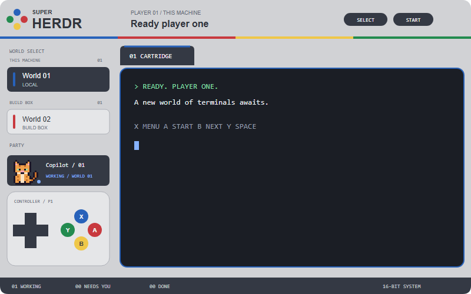

# Super Herdr

A light-grey European/Japanese SNES-inspired console around a terminal workspace. A four-colour stripe, cartridge tabs, and a working controller make navigation playful; Pixelherd animals represent agents without replacing the SNES sidebar or headers.



## What you see

- An 82px console header in `#d1d2d5`, a four-dot jewel mark, SUPER HERDR branding, active space/machine text, a power lamp, SELECT/START, settings, and platform window controls.
- A 4px stripe in blue `#2862ba`, red `#c8393e`, yellow `#efc748`, and green `#238b4f`.
- A 252px sidebar with WORLD SELECT space cards grouped under 24px machine headings and space counts, PARTY agent rows, and a fixed controller below the scrollable lists. THIS MACHINE comes first, then named remotes. Long machine names truncate and have a full-name tooltip. Agent rows remain 57px tall, with 48px animal avatars and existing agent/tab/status/space labels.
- A 36px cartridge tab strip above the active terminal. Terminal frames use 2px borders, 12px corners, 8px split gaps, a blue focus border, and 14px terminal padding.
- A 34px charcoal footer with working/blocked/done counts, machine count, app menu, and a clock.
- Geist for UI headings, Geist Mono for small console labels. The terminal uses the user's font preference. Terminal background is `#1b1e25`; foreground is `#e8ebf1`. The theme picker can override the layout's look.
- Controller face buttons: blue X at the top, red A at the right, yellow B at the bottom, green Y at the left. Do not use the purple North American controller palette.

## How it behaves

- D-pad left/right selects the previous/next tab. Up/down selects the previous/next space. Center zooms the focused pane.
- Group spaces by their `machine` field, treating null/missing as this machine. Show only groups containing spaces: local first, then remotes sorted by name. Preserve each group's native space order, original global numbers, and card colours. Include spaces whose machine is offline or absent from `machines()`. The D-pad continues to use native global space order rather than the visually grouped order.
- X and SELECT open the command palette. A, START, and the tab `+` open the terminal/agent creation menu. B focuses the next agent. Y and NEW SPACE create a space.
- If remote machines are configured, creating a space opens a local/remote picker. Only ready machines can be selected. An explicit empty machine name creates locally.
- Space, tab, and agent cards focus their own targets. Right-clicking opens the clicked item's menu, not a menu for whatever was previously selected. The footer and chrome expose the global menu.
- Window controls minimize, maximize/restore, and close. Their mouse-down handlers stop propagation so they do not drag the title bar. macOS gets traffic-light clearance.
- An agent's terminal address determines its animal using FNV-1a, in the order duck, frog, cat, penguin. Assignment stays stable when the list is reordered or status changes.
- Working: blue status, animal bobs from top 0 to -3px over 700ms. Blocked: red NEEDS YOU status and a pulsing indicator; the header power lamp pulses too. Done: green DONE, without inventing a new animal animation. Idle: yellow STANDING BY and a boxed `z`.
- Animals are the only Pixelherd visualization reused. Do not import its sidebar, scene background, dock, headers, sorting, or worktree behavior.
- Settled tabs stay hidden and native next/previous tab commands skip them. Hovers highlight clickable controls.
- All motion uses native GPUI loops, not redraw timers. Only the footer copy runs a 15-second clock timer.

## Built from

The root is a column in `layouts/snes.json`, with the graphite theme and an inline colour palette:

```text
root
  top: snes { part: "top" }, draggable
  body: non-resizable row
    sidebar: snes { part: "side" }, 252px
    work: non-resizable column, padding [10, 12], gap 8
      tabs: snes { part: "tabs" }, 36px
      main: active tab with framed panes
  bottom: snes { part: "bottom" }, 34px
```

`mods/snes/main.js` default-exports a GPUI `View`. Its fifth part, `machines`, renders the space-creation popup. `mod.json` has `place: "none"` so it is only mounted by the layout or popup.

Use `div`, `image`, `svg`, `h_flex`, and `v_flex`, not HTML/CSS. Live data comes from `spaces()`, `agents()`, `machines()`, `props()`, and `window()`. `setAgentOrder()` matches the sidebar order. `run()`, `openOverlay()`, and `closeOverlay()` handle actions.

Reuse Herdr's shipped `menu` and `new-menu` mods, `mods/workspace-chrome/settings.svg`, and `mods/tabs/win-{min,max,restore,close}.svg`. Keep the logical `mods/snes/` asset paths consistent with the mod name.

Bundle Pixelherd's `duck.svg`, `frog.svg`, `cat.svg`, and `penguin.svg` under `mods/snes/sprites/`. Render them in full colour using `image()`, not tinted `svg()`. Preserve the source attribution and Apache-2.0 license. Keep the MIT license for the LCARS-derived UI patterns.

There are no network calls, external program executions, filesystem reads, or dependencies on a separately installed Pixelherd or LCARS layout. The clean preview contains only fictional content.

## Watch out

- Start with Herdr 0.1.14's API or a compatible newer version. Shipped layouts and mods are read-only; add a separate `snes` layout/mod instead.
- The Windows installer updates existing Super Herdr installations, identified by the `Super Herdr` title in `mods/snes/mod.json`. Updates replace only bundled theme files, including local edits to those files; unlisted files and user configuration are preserved. Refuse unrelated `snes` name conflicts. Renaming requires updating the layout's mod names, self-referencing popup name, and logical asset paths together.
- Keep saved user state, machine details, settings, shortcuts, and generated editor declarations out of the package.
- Native mod checks cover eager rendering only. Exercise all five parts and non-empty working/blocked/done/idle agent lists as well.
- Keep the titlebar controls usable on Windows and leave native macOS button space. Narrow windows truncate labels; the sidebar width is fixed.
- Use callback-local `cx`. Do not retain it or animate by notifying on a timer.
- A terminal program may paint its own background or retain its own colour theme independently.
- Do not copy game characters or copyrighted game sprite sheets into the package. These are licensed Pixelherd animal assets, not SNES game sprites.

## Done when

- `herdr-app check` succeeds for the installed SNES mod and `herdr-app status` reports `layout: "snes"` without errors after switching.
- The header, sidebar, tab strip, terminal, and footer render with the European/Japanese controller colours.
- Left/right changes tabs; up/down changes spaces; the centre still zooms. X/A/B/Y and SELECT/START have the actions above.
- Animals retain their identity across status changes and reordering. Working motion is visible between rendered frames; idle adds `z`; blocked pulses.
- Agent and context-menu clicks target the correct agent/pane. Local and ready-remote space creation use the correct machine.
- Local-only, remote-only, mixed/interleaved, offline/unknown-machine, and empty space lists render without missing or duplicated spaces. Machine counts and local-first/name-sorted headings are correct; long labels do not displace counts.
- Only animal avatars are taken from Pixelherd; the SNES pane, headers, backgrounds, row height, and labels remain.
- The installer supports fresh installs and repeat updates, repairs missing bundled files in a recognized installation, preserves unrelated/custom files and configuration, and makes no changes with `-WhatIf`. It refuses unrelated name collisions, non-file destinations, and incomplete packages, reports validation failures, and never changes the active layout itself.
